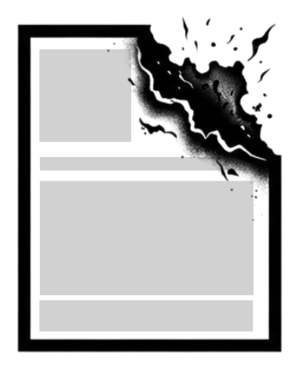
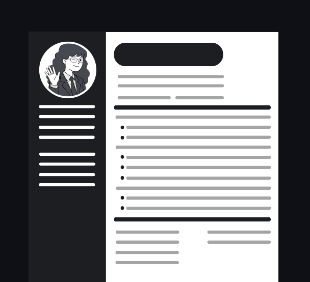
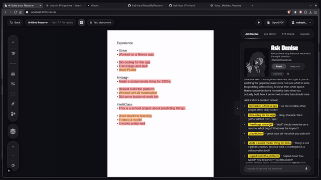

<div align="center">
  

  <h1>RoastMyResume — Resume Canvas Builder</h1>

  <h3>Build sharp. Get roasted. Apply stronger.</h3>

  <p>
    
    
  </p>

  <p>
    <b>Student:</b> Yhvhan Suba &nbsp;|&nbsp; <b>Website Category:</b> Business, Entertainment
  </p>
</div>

<br />

<p align="center">
  
</p>

##  Video Demonstration

<p align="center">
  <a href="public/assets/videos/roastmyresume.mp4">
    
  </a>
  <br />
  <sub>Select the preview to watch the complete 3-minute, 20-second website demonstration.</sub>
</p>

> [!NOTE]
> **RoastMyResume** is an AI-powered resume builder and reviewer. Create or import a resume, shape it on a visual canvas, choose a professional template, then get direct AI feedback—from a playful roast to practical rewrites—alongside ATS and job-match analysis.

---

##  What it does

RoastMyResume blends a serious job-search tool with an entertaining personality. It gives users a hands-on way to design a resume while **Denise**, the built-in AI companion, calls out vague writing, helps rewrite weak content, and keeps the focus on a stronger application.

<p align="center">
  
  <br />
  <sub>Denise is thinking.</sub>
</p>

<table>
  <tr>
    <td width="50%" valign="top">
      <h3> Design without limits</h3>
      <p>Arrange text, images, icons, shapes, dividers, and handwritten marks on a freeform resume canvas.</p>
    </td>
    <td width="50%" valign="top">
      <h3> Improve with personality</h3>
      <p>Turn vague claims into clear, measurable statements through AI reviews, resume roasts, and actionable suggestions.</p>
    </td>
  </tr>
</table>

##  Main features

- **Freeform resume canvas** — Drag, resize, group, lock, flip, layer, align, and style resume elements. The editor includes text controls, image support, shapes, dividers, icons, a pen tool, snapping, zoom, copy/paste, and undo/redo.
- **Professional templates** — Start from a blank page or choose from seven layouts across ATS-friendly, business, tech, and generic styles.
- **PDF resume import** — Upload a PDF resume and have AI extract its content into editable canvas elements.
- **PDF export** — Download the finished A4 resume as a PDF.
- **AI resume review** — Submit resume text or screenshots for either a theatrical **Roast** or direct, constructive **Real Talk** feedback.
- **Ask Denise** — Chat with the in-canvas AI assistant, see weak phrases highlighted, and apply suggested rewrites directly to the resume.
- **ATS Check** — Analyze the current resume for applicant-tracking-system readiness and content issues.
- **Job Match** — Compare the resume with a pasted job description or up to three job-listing screenshots.
- **Voice-enabled assistance** — Speak to Denise through speech-to-text and hear replies through text-to-speech.
- **Accounts and safeguards** — Sign up using email OTP verification or Google, with per-feature daily AI usage limits.
- **Icon library** — Search and add resume-relevant icons, with CDN-backed caching for fast canvas rendering.

##  Technology stack

### Front end

| Technology | How it is used |
| :--- | :--- |
| **Next.js 16** | App Router application, pages, layouts, and server API routes |
| **React 19 + TypeScript** | Component architecture and type-safe UI development |
| **Tailwind CSS 4** | Responsive, utility-first styling |
| **React Context + browser storage** | Canvas/editor state and local session persistence |
| **Framer Motion + GSAP** | Page and interface animations |
| **OGL + Lottie React** | Animated visual backgrounds and scan/loading sequences |
| **Base UI, shadcn, Lucide React, React Icons** | Accessible UI primitives and iconography |
| **jsPDF + modern-screenshot** | A4 resume capture and PDF export |

### Backend, data, and external APIs

| Service / API | How it is used |
| :--- | :--- |
| **Next.js Route Handlers** | Backend endpoints for reviews, imports, AI tools, auth, voice, templates, icons, and rate limits |
| **Anthropic Claude Haiku 4.5** | Resume review, Denise conversations, ATS checks, job matching, and PDF content extraction |
| **Firebase Authentication + Cloud Firestore** | Google sign-in, user records, templates, AI rate limits, and icon metadata/cache |
| **Cartesia** | AI text-to-speech for Denise |
| **Deepgram** | Audio transcription and short-lived browser streaming tokens |
| **Nodemailer + Gmail SMTP** | Email one-time-password verification |
| **Cloudinary** | Cached SVG icon storage and CDN delivery |
| **Iconify + jsDelivr fallbacks** | Icon search and resilient SVG retrieval |

##  How to use the website

1. **Create an account or sign in.** Use Google sign-in or email registration. Email registration sends a six-digit verification code.
2. **Choose your starting point.** Open **Templates** and select a layout, start from a blank canvas, or import an existing PDF resume.
3. **Build your resume.** Add and edit text, images, shapes, dividers, and icons. Use the selection tools to move, resize, arrange, group, or lock elements.
4. **Ask for feedback.** In the assistant panel, use **Ask Denise** for a roast or focused improvement help. Apply suggested rewrites when they fit your experience.
5. **Check the fit.** Run **ATS Check** for scan-readiness, then use **Job Match** with the target job description or screenshots to identify gaps.
6. **Polish and export.** Make final changes, then select the export action to download the resume as an A4 PDF.

> [!TIP]
> The AI is most useful when your resume includes specific outcomes: measurable results, scale, tools used, and the context behind each accomplishment.

##  Run locally

```bash
# 1. Install dependencies
npm install

# 2. Add the required service credentials to .env.local
#    (Firebase, Anthropic, Deepgram, Cartesia, Gmail SMTP, and Cloudinary)

# 3. Start the development server
npm run dev
```

Open [http://localhost:3000](http://localhost:3000) in your browser.

<details>
  <summary><b>Available scripts</b></summary>
  <br />

  | Command | Purpose |
  | :--- | :--- |
  | `npm run dev` | Start the local Next.js development server |
  | `npm run build` | Create a production build |
  | `npm run start` | Run the production build locally |
  | `npm run lint` | Run ESLint |
</details>

---

<div align="center">
  <sub>Designed and developed by <b>Yhvhan Suba</b> · RoastMyResume</sub>
</div>
